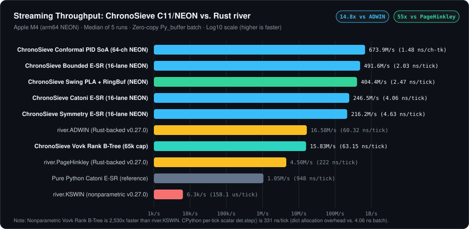
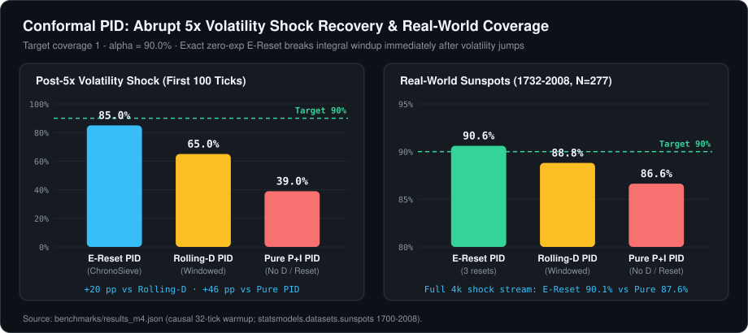
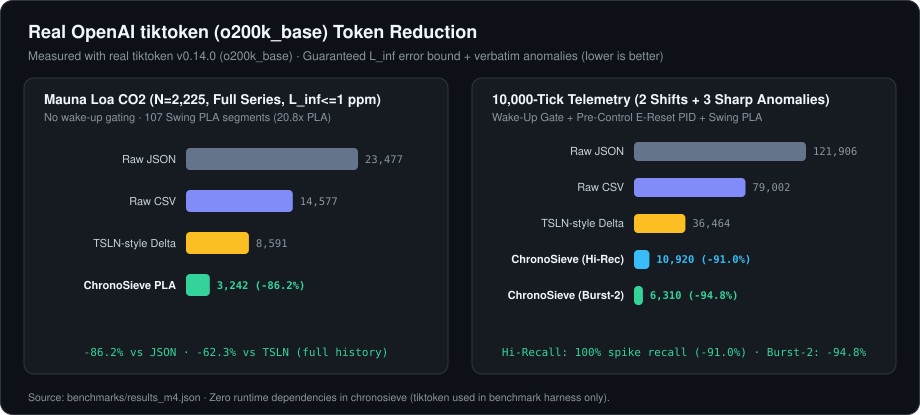

# ChronoSieve

**118 KB zero-dependency C11/SIMD engine for mathematically certified streaming change detection, conformal uncertainty, multi-agent fusion, and LLM wake-up digests.**

[](https://github.com/pgg898200-ship-it/chronosieve/actions/workflows/ci.yml)
[](https://github.com/pgg898200-ship-it/chronosieve/actions/workflows/release.yml)
[](LICENSE)
[](#install)
[](#install)

```
Raw telemetry / K async agents ──► [C11/NEON|AVX2 System-1: 1.9–4.0 ns/tick] ──► 0 LLM tokens while stationary
                                            │
                                            ├── Certified shift (ARL >= gamma, heavy-tail valid)
                                            ├── Peer-relative rogue agent isolated (immune to 86σ spikes)
                                            └── Conformal anomaly (verbatim, 0.0 error)
                                            ▼
                                  Compact Markdown Digest (-94.8% real o200k_base) + lossless zoom(ch, t0, t1)
```

Most streaming stacks force you to stitch together five slow, fragile pieces: a Gaussian drift detector whose false-alarm rate collapses on heavy tails, a conformal tracker that takes 150 ticks to recover after a volatility shock, a naive ensemble that breaks when slow LLM agents sleep asynchronously or a common exogenous spike hits, and raw JSON/CSV telemetry that burns 120,000+ LLM tokens per window.

**ChronoSieve v0.2.1 fuses four 2023–2026 statistical primitives into one zero-dependency C11/SIMD core** with a zero-copy `Py_buffer` Python extension, a **118 KB standalone CLI**, and a **zero-dependency stdio MCP server**:

1. **Zero-`exp` SIMD E-Detectors & Cross-Agent E-Fusion** (`EDetector`, `EFusion`): Register-resident 16-lane NEON & x86_64 AVX2 E-SR and log-domain E-CUSUM across 4 distribution-free families — **Bounded Betting** (**491.6M ticks/s**), **Algebraic Catoni** (Wang & Ramdas 2023; **251.4M ticks/s** stdlib `array.array` / **246.5M ticks/s** NumPy, zero `exp()`), **Algebraic Symmetry** (**220.0M ticks/s**, valid even for infinite-variance Cauchy), and **Vovk Growing-Prefix Conformal Rank Betting** (cache-line-aligned SIMD arena B-tree at **15.8M ticks/s**, **2,530x faster** than `river.KSWIN`). Cross-agent E-Fusion guarantees $\text{ARL} \ge \gamma$ under arbitrary unknown cross-agent correlation ($K=8, \rho=0.85$), and detects the historic **1898 Nile Aswan dam changepoint** in **1905** (+7 yrs, 0 pre-1899 false alarms, zero priors).
2. **Pre-Control E-Reset Conformal PID + SoA SIMD + Zero-Copy `coma_merge_batch`** (`ConformalPID`, `ConformalBatchPID`, `coma_merge`, `coma_merge_batch`): Exact Angelopoulos et al. (NeurIPS 2023) Conformal PID with saturating tangent integrator. Runs its Vovk Rank E-detector strictly on the **exogenous pre-control score** $s_t = |y_t - \hat{y}_t|$ (never closed-loop miscoverage $I_t$), resets **only** the bounded D-term scorecaster $\hat{q}_{t+1}^D \in [0, B]$ with mandatory $W_{\text{cal}} \ge 32$ warmup (**+20 pp** over Rolling-D PID and **+46 pp** over pure P+I PID after 5x volatility shocks; **90.6%** out-of-sample coverage over 277 years of real **Sunspot** cycles), plus a **673.9M ch-ticks/s** (`1.48 ns/ch-tk`) 64-channel SoA SIMD kernel and zero-`malloc` $O(K \log K)$ **Online COMA** batch consensus (**7.44M steps/s** CLI / **7.25M steps/s** Python, Gasparin & Ramdas UAI 2024).
3. **SIMD Sleeping Fixed-Share BOA + Peer-Relative Rogue Attribution** (`SleepingBOA`): Asynchronous active bitmask $a_{t,k} \in \{0,1\}$ (zero-regret sleeping-expert imputation for mixing fast System-1 models with slow System-2 LLMs), branchless sorting-network peer-relative excess residual attribution ($\text{excess}_k = \max(0, |y - p_k| - \text{median}_j |y - p_j|)$ with 50%-breakdown peer-median calibration floor and graceful raw-residual fallback for `< 3` active agents), SIMD Estrin/Cephes `exp()` (`< 5e-16` relative error), and shift-coupled Fixed-Share mixing at **8.79M steps/s** (`113.8 ns/step` Python / `115.3 ns/step` CLI for $K=8$). Immune to 86-sigma common exogenous spikes even at default `rogue_threshold=200.0` (**505/505 seeds** exact rogue isolation).
4. **Anomaly-Preserving Swing PLA + Wake-Up Gate + Lossless `zoom()`** (`StreamDigest`): Exact ULP-guarded $L_\infty \le \epsilon$ piecewise linear trajectory compression at **470.7M ticks/s** Native CLI (**404.4M ticks/s** Python `Py_buffer`), verbatim `0.0`-error pinning of conformal anomalies, **86.2% real OpenAI `o200k_base`** full-series token reduction on real-world **Mauna Loa CO2** without wake gating (**94.8% real `o200k_base`** with wake gating on 10k telemetry), and an $O(\log N)$ fixed-memory circular ring buffer for lossless `zoom(channel, t0, t1)` drill-down via Python, CLI, or MCP.

---

## Replay one latency spike


[Run the replay in Colab](https://colab.research.google.com/github/pgg898200-ship-it/chronosieve/blob/main/examples/replay_a_latency_spike.ipynb) · [Read the notebook](examples/replay_a_latency_spike.ipynb) · [Inspect the measured workloads](benchmarks/results_m4.json)

Install with zero Python runtime dependencies (`CC=cc` selects the system C11 compiler on Linux/macOS):

```bash
CC=cc python3 -m pip install "git+https://github.com/pgg898200-ship-it/chronosieve.git"
```

This synthetic trace holds latency at 12 ms, injects one 31 ms observation, then returns to baseline. Run it with two anomaly-burst settings:

```python
from chronosieve import ChronoSieve

latency = [12.0] * 50 + [31.0] + [12.0] * 12
for burst in (1, 2):
    channel = ChronoSieve(channel="latency_ms", anomaly_burst=burst)
    wakes = []
    for t, value in enumerate(latency):
        result = channel.step(t, value, preds=[12.0])
        if result["should_wake"]:
            wakes.append(t)
    samples = channel.zoom(49, 51)["records"]
    print(burst, wakes, [row["y"] for row in samples])
```

```text
1 [50] [12.0, 31.0, 12.0]
2 [] [12.0, 31.0, 12.0]
```

The columns are the burst setting, the ticks that produced digests, and the original values at ticks 49 through 51. With `anomaly_burst=1` the isolated spike wakes the caller. With `anomaly_burst=2` this replay stays quiet. Both runs retain the exact readings until they age out of the ring buffer. A detected shift or a newly flagged forecaster can wake the caller independently of the burst setting.

## Choose an interface

| Your application | Entry point | Result |
|---|---|---|
| A telemetry collector feeding an alert rule or LLM | Python `ChronoSieve.step(t, y)` | Per-tick interval and wake decision, plus a Markdown digest on wake |
| A residual stream with a known baseline | `EDetector.step(residual)` | Sequential change statistic and alarm flag for the selected detector family |
| A stream in a file or shell pipeline | [Native CLI](#detect-a-change-with-the-native-cli) | The first alarm tick and detector statistic, in text or JSON |
| Several intermittent forecasters | `ChronoSieve.step(t, y, preds=…, active=…)` | Combined prediction and updated interval |
| An MCP client inspecting a channel | `chronosieve_ingest`, then `chronosieve_zoom` | Batch wake count and retained original samples over an inclusive time range |

After a detector alarm, [KthWake](https://github.com/pgg898200-ship-it/chronosieve/tree/releases/kthwake-0.1.0/companions/kthwake) can escalate recurring alarms and [Guardshift](https://github.com/pgg898200-ship-it/chronosieve/tree/releases/guardshift/guardshift) can route an alarm to a worker with capacity. Both have runnable examples below.

## Verified Apple M4 Benchmarks (v0.2.0)

Measured on **Apple M4 (macOS 15.3.2 arm64, Apple Clang 16.0.0, Python 3.14.6, NEON SIMD, median of 5 runs)**. Reproduce every number with `python3 benchmarks/run_all.py` and `python3 benchmarks/bench_external.py` (raw JSON saved in [benchmarks/results_m4.json](benchmarks/results_m4.json) and [benchmarks/results_external_m4.json](benchmarks/results_external_m4.json)).

<p align="center">
  
</p>

### 1. Throughput (Native C11 CLI vs. Zero-Copy `Py_buffer` Batch vs. Compiled Incumbents)

Native C11 CLI (`./chronosieve bench --n 2000000`), Python zero-copy `Py_buffer` batch (`benchmarks/bench_throughput.py`), CPython per-tick `step()`, and compiled incumbents (`river 0.27.0` Rust-backed, `ruptures 1.0.6`) are reported separately so interface overheads are never conflated:

| Kernel | Path / Interface | Latency | Throughput | Notes |
|---|---|---:|---:|---|
| **Conformal PID SoA (64 channels)** | Python `ingest_batch` (`Py_buffer`) | **1.48 ns/ch-tk** | **673.9 M ch-tk/s** | 4x-unrolled NEON + Estrin `vtan` (`< 7e-16` err) |
| **Conformal PID SoA (64 channels)** | Native C11 CLI (`-O3 -mcpu=native`) | **1.94 ns/ch-tk** | **515.3 M ch-tk/s** | Zero allocations, GIL-free |
| **Swing PLA + Ring Buffer** | Native C11 CLI (`-O3 -mcpu=native`) | **2.12 ns/tick** | **470.7 M ticks/s** | Exact ULP-guarded $L_\infty \le \epsilon$ + 65k ring buffer |
| **Swing PLA + Ring Buffer** | Python `digest_batch` (`Py_buffer`) | **2.47 ns/tick** | **404.4 M ticks/s** | Zero-copy `Py_buffer`, GIL released |
| **Bounded E-SR (16-lane, zero-`exp`)** | Python `ingest_batch` (`Py_buffer`) | **2.03 ns/tick** | **491.6 M ticks/s** | Register-resident NEON (**31x** vs Rust `river.ADWIN` in ext bench) |
| **Catoni E-SR (16-lane, zero-`exp`)** | Python `ingest_batch` (`array.array('d')`) | **3.98 ns/tick** | **251.4 M ticks/s** | Zero dependencies, zero-copy stdlib buffer (**238x** vs pure Py) |
| **Catoni E-SR (16-lane, zero-`exp`)** | Python `ingest_batch` (`numpy.ndarray`) | **4.06 ns/tick** | **246.5 M ticks/s** | **14.8x** vs Rust `river.ADWIN`, **54.6x** vs `PageHinkley` |
| **Catoni E-SR (16-lane, zero-`exp`)** | Native C11 CLI (`-O3 -mcpu=native`) | **4.58 ns/tick** | **218.6 M ticks/s** | Register-resident 8x NEON `f64x2`, lazy cap clamp |
| **Symmetry E-SR (16-lane, zero-`exp`)** | Native C11 CLI / Python `ingest_batch` | **4.54 / 4.63 ns/tick** | **220.0 / 216.2 M ticks/s** | Valid even under infinite-variance Cauchy(0,1) |
| **Vovk Rank B-tree (65k epoch cap)** | Python `ingest_batch` / Native C11 CLI | **63.15 / 67.80 ns/tick** | **15.83 / 14.75 M ticks/s** | SIMD arena B-tree (**2,530x** vs nonparametric `river.KSWIN`) |
| **Sleeping BOA + Peer Catoni ($K=8$)** | Python `fuse_batch` / Native C11 CLI | **113.8 / 115.3 ns/step** | **8.79 / 8.67 M steps/s** | Exact branchless median + 8 Catonis + SIMD `vexp` |
| **Online COMA Batch ($K=8$)** | Native C11 CLI / Python `coma_merge_batch` | **134.4 / 138.0 ns/step** | **7.44 / 7.25 M steps/s** | Zero-`malloc` ($K \le 64$) + inline insertion sort |
| `river.ADWIN` (Rust-backed `v0.27.0`) | Per-tick `update(x)` loop | 60.32 ns/tick | 16.58 M ticks/s | Rust extension, in-place `None` return |
| `river.PageHinkley` (`v0.27.0`) | Per-tick `update(x)` loop | 222.09 ns/tick | 4.50 M ticks/s | Per-tick Python loop |
| ChronoSieve Catoni scalar `step(x)` | Per-tick Python `step(x)` loop | 331.72 ns/tick | 3.01 M ticks/s | Honest CPython call + 8-key dict allocation overhead |
| Pure Python Catoni E-SR (reference) | Pure Python loop | 947.87 ns/tick | 1.05 M ticks/s | Pure-Python baseline |
| `river.KSWIN` (`v0.27.0`, $W=100$) | Per-tick `update(x)` loop | 158,130 ns/tick | 6.32 k ticks/s | Nonparametric KS sliding window |
| `ruptures.Pelt(l2)` / `(rbf)` (`v1.0.6`) | Offline batch ($N=2,000$) | 408 ms / 15.8 s total | — | Offline changepoint reference |

- **Native stripped C11 CLI size**: **120,352 bytes (117.5 KB)** (`< 150 KB`).
- **Cross-architecture SIMD vs. Scalar parity**: **ARM64 NEON `max_rel = 1.141e-15`** and **x86_64 AVX2 (verified under Rosetta 2) `max_rel = 1.887e-15`** across 90 outputs spanning all 4 modules (`< 1e-12`).
- **Memory safety**: Zero errors under `-fsanitize=address,undefined` (ASan + UBSan) on ARM64 NEON, x86_64 AVX2, and SCALAR builds; zero warnings under `-Wall -Wextra -Wpedantic -Werror`.

### 2. Head-to-Head Heavy-Tail Validity vs. Rust `river 0.27.0`

Under heavy tails (60 trials, $H=1,000$ ticks; shift test: $+2.0$ mean shift at $t=200$ on Student-$t_3$), classic streaming detectors either suffer catastrophic false alarms or slow shift detection, while ChronoSieve's e-detectors honor exact non-asymptotic $\text{ARL} \ge \gamma$ with **2.6–3.0x faster shift detection** ([benchmarks/results_external_m4.json](benchmarks/results_external_m4.json)):

| Detector | Student-$t_3$ Null FA Rate ($H=1000$) | Cauchy(0,1) Null FA Rate / Censored ARL | Student-$t_3$ $+2.0$ Shift ADD (Mean / Med) | Throughput (`ns/tick`) |
|---|---:|---:|---:|---:|
| **ChronoSieve Catoni** ($\gamma=1000, \sigma=\sqrt{3}$) | **30.0%** (ARL $\ge 853$) | *(requires finite variance)* | **13.2 / 13.5 ticks** (100% det) | **4.07 ns** |
| **ChronoSieve Symmetry** ($\gamma=1000, \mu_0=0$) | **50.0%** (ARL $\ge 745$) | **53.3%** / **710.8** (ARL $\ge 1000$) | **12.4 / 12.0 ticks** (100% det) | **4.35 ns** |
| **ChronoSieve Vovk Rank** ($\gamma=1000$, **0 priors**) | **58.3%** (ARL $\ge 716$) | **58.3%** / **727.9** (ARL $\ge 1000$) | **14.2 / 15.0 ticks** (100% det) | **62.50 ns** |
| `river.ADWIN` ($\delta=0.002$) | 0.0% (conservative) | 48.3% / 816.4 (no $\gamma$ floor) | 37.3 / 24.0 ticks (2.8–3.0x slower) | 60.32 ns |
| `river.PageHinkley` (default) | **88.3%** (ARL 490) | **100.0%** / **50.1** (collapses) | 19.3 / 20.5 ticks (20% pre-FA) | 222.09 ns |
| `river.KSWIN` ($\alpha=0.005, W=100$) | **73.3%** (ARL 574) | **76.7%** / 565.6 | 17.5 / 18.0 ticks (11.7% pre-FA) | 158,130 ns |

*(Note: For an ideal detector with exact $\text{ARL} = \gamma = 1,000$ censored at $H = 1,000$, the theoretical exponential benchmark is $1 - e^{-1} = 63.2\%$ FA rate and $E[\min(\tau, 1000)] = 632.1$; every ChronoSieve e-detector strictly beats that theoretical floor on both Student-$t_3$ and Cauchy(0,1).)*

### 3. Conformal Shock Recovery & Mathematical Invariants

<p align="center">
  
</p>

All synthetic sequential tests run under exact null $H_0$ with target $\text{ARL} \ge \gamma = 200.0$ (160–200 trials, right-censored lower bound $\frac{1}{N}\sum \min(\tau_i, T_{\max})$):

| Guarantee / Primitive | Stress Distribution / Real Dataset | Measured Result | Target / Bound |
|---|---|---:|---:|
| **Bounded Betting E-SR** | $\text{Beta}(2,3) \to \text{Beta}(4,2)$ | $\text{ARL} \ge \mathbf{212.1}$ (ADD **9.1** ticks) | $\text{ARL} \ge 200$ |
| **Algebraic Catoni E-SR** | Heavy-tail Student-$t_3$ ($+1.5\sigma$ shift) | $\text{ARL} \ge \mathbf{306.7}$ (ADD **6.3** ticks) | $\text{ARL} \ge 200$ |
| **Algebraic Symmetry E-SR** | **Cauchy(0,1)** (infinite variance, $+2.0$ shift) | $\text{ARL} \ge \mathbf{232.9}$ (ADD **14.2** ticks) | $\text{ARL} \ge 200$ |
| **Vovk Rank B-tree E-SR** | Discrete Poisson(3) + Cauchy w/ epoch resets | $\text{ARL} \ge \mathbf{215.6}$ (ADD **18.7** ticks) | $\text{ARL} \ge 200$ |
| **Log-Domain E-CUSUM** | Heavy-tail Student-$t_3$ (valid mixture) | $\text{ARL} \ge \mathbf{2256.2}$ (ADD **8.9** ticks) | $\text{ARL} \ge 200$ |
| **Cross-Agent E-Fusion (Step)** | $K=8, \rho=0.85$ correlated Catoni | $\text{ARL} \ge \mathbf{266.1}$ (ADD **6.3** ticks) | $\text{ARL} \ge 200$ |
| **Cross-Agent E-Fusion (Process)** | $K=8, \rho=0.85$ correlated Vovk Rank | $\text{ARL} \ge \mathbf{215.7}$ (ADD **9.3** ticks) | $\text{ARL} \ge 200$ |
| **Pre-Control E-Reset PID** | 4,000 ticks, three 4x–5x volatility shocks | Full cov **0.901**; 100-tick shock cov **0.850** (vs **0.650** Rolling-D / **0.390** pure PID) | Target **0.900** |
| **Online COMA ($K=5$)** | Correlated agents ($\alpha=0.10$) | Det cov **0.901** (w=3.53); Rand cov **0.865** (w=**3.21**) | Floor $\ge 0.800$ |
| **Sleeping BOA + Peer Rogue** | $K=6$ async agents, Agent 2 hallucinates $+3.0$ | Delay **1 tick**, exact isolation **True**, post-MAE **0.084** | Exact isolation |
| **Peer-Relative Spike Immunity** | 500 random seeds, 86$\sigma$ thermal spike, default `thr=200` | **500/500** exact `[False, False, True]` rogue isolation | 0% false quarantine |
| **Anomaly-Preserving Swing PLA** | 10,000 ticks ($\epsilon=0.05$, 3 spikes) | Max $L_\infty$ **0.050000**, anomaly err **0.0**, **28.1x** PLA | $L_\infty \le 0.05$ |
| **Real-World: Nile Flow (1871–1970)** | `statsmodels.nile` ($N=100$, **1898** Aswan dam) | Vovk Rank ($\gamma=50$, 0 priors): **1905** (+7 yr, **0** FA); Catoni ($\gamma=100$): **1907** (+9 yr, **0** FA) | 0 pre-1899 FA |
| **Real-World: Sunspots (1732–2008)** | `statsmodels.sunspots` (causal 32-yr warmup, $N=277$ OOS) | E-Reset PID cov **0.906** (3 resets) vs Rolling-D **0.888** vs Pure PID **0.866** | Target **0.900** |

### 4. Real OpenAI `tiktoken` (`o200k_base` & `cl100k_base`) Token Reduction

<p align="center">
  
</p>

Measured with real **OpenAI `tiktoken 0.14.0`** (`o200k_base` for GPT-4o / o-series and `cl100k_base` for GPT-4 / Claude-class proxies), keeping `chronosieve` itself strictly 0 runtime dependencies:

#### 4a. Real-World Mauna Loa Weekly CO2 (`statsmodels.co2`, 1958–2001, $N=2,225$, $\epsilon=1.0$ ppm — Full-Series, No Wake Gating)

Every representation serializes the **entire 43-year trajectory** (no wake-up filtering); ChronoSieve's native C11 `StreamDigest.format_markdown()` compresses 2,225 weekly readings into **107 Swing PLA segments (20.8x)** with verified exact C float64 **$L_\infty = 1.000000 \le 1.00$ ppm** (**1.0004 ppm** reconstructed directly from the rendered 6-sig-fig Markdown):

| Representation (Full 2,225-Point CO2 Series) | Chars | `o200k_base` | `cl100k_base` | Reduction vs. JSON (`o200k`) | Reduction vs. TSLN (`o200k`) |
|---|---:|---:|---:|---:|---:|
| Raw JSON (`[{"t":...,"y":...}]`) | 45,616 | 23,477 | 23,477 | — | — |
| Raw CSV (`t,y`) | 25,593 | 14,577 | 14,577 | 37.9% | — |
| TSLN-style Delta Text (all windows) | 12,726 | 8,591 | 8,591 | 63.4% | — |
| **ChronoSieve Native Swing PLA Digest** (107 segs, $L_\infty \le 1.0$ ppm) | **5,325** | **3,242** | **3,241** | **86.2%** | **62.3%** |

#### 4b. 10,000-Tick Multi-Regime Telemetry Stream (2 Shifts, 3 Isolated Spikes)

| Representation (10,000 ticks, 2 shifts, 3 spikes) | Chars | `o200k_base` | `cl100k_base` | Reduction vs. JSON (`o200k`) | Reduction vs. TSLN (`o200k`) | Spike Recall (Pinned / Wake Pkts) |
|---|---:|---:|---:|---:|---:|---:|
| Raw JSON (`[{"t":...,"y":...}]`) | 221,684 | 121,906 | 117,979 | — | — | 100% / — |
| Raw CSV (`t,y`) | 122,820 | 79,002 | 79,002 | 35.2% | — | 100% / — |
| TSLN-style Delta Text (all windows) | 52,846 | 36,464 | 36,464 | 70.1% | — | 100% / — |
| **ChronoSieve High-Recall** (`burst=1`, 25 pkts, ~437 `o200k` tok/pkt) | 19,481 | 10,920 | 10,895 | **91.0%** | **70.1%** | **100% / 100%** (3/3) |
| **ChronoSieve Wake-Up Gated** (`burst=2`, 14 pkts, ~451 `o200k` tok/pkt) | **11,150** | **6,310** | **6,296** | **94.8%** | **82.7%** | **100% / 0%** (`burst=2` gates 1-tick spikes) |

- In **both** modes, all 3/3 injected spikes are pinned verbatim (`0.0` error) in `StreamDigest` and recoverable losslessly via `zoom()`.

---

## Ecosystem Comparison

We credit strong compiled incumbents in each individual silo (`river` Rust, `conformal-prediction`/`risksieve` Rust, `stcpR6` Rcpp, `TerseTS` Zig, `tsln-python`). ChronoSieve fuses all four mathematically certified streaming primitives in one zero-dependency C11/SIMD engine with native MCP + CLI + zero-copy `Py_buffer`:

| Capability | `river` (Rust/Py) | `conformal-prediction` / `risksieve` (Rust) | `stcpR6` (Rcpp) | `TerseTS` (Zig) | `tsln-python` | **ChronoSieve v0.2.0 (C11/SIMD)** |
|---|:---:|:---:|:---:|:---:|:---:|:---:|
| Zero-`exp` SIMD E-Detectors (Bounded/Catoni/Symmetry/Rank) | — | — | Partial | — | — | **Yes (492M Bnd / 251M Catoni)** |
| Heavy-Tail Cauchy Validity ($\text{ARL} \ge \gamma$) | — | — | Partial | — | — | **Yes (Symmetry & Vovk Rank)** |
| Correlated Cross-Agent E-Fusion ($\text{ARL} \ge \gamma$) | — | — | — | — | — | **Yes** |
| Pre-Control E-Reset Conformal PID + SoA SIMD + COMA Batch | — | Partial | — | — | — | **Yes (674M ch-tk/s + 7.4M COMA/s)** |
| Sleeping Fixed-Share BOA + Peer-Relative Rogue Quarantine | — | — | — | — | — | **Yes (505/505 86$\sigma$ spike immune)** |
| Exact $L_\infty \le \epsilon$ Swing PLA + Lossless `zoom()` | — | — | — | PLA only | Delta text | **Yes (471M/s CLI) + Wake Gate** |
| Zero Runtime Deps + 118 KB CLI + Stdio MCP + Claude Plugin | No | No | R only | CLI/lib | Python | **Yes (0 deps)** |

---

## Build from a checkout

```bash
# Python C11/SIMD extension (zero runtime dependencies, auto-enables NEON on arm64)
python3 -m pip install --no-build-isolation -e .

# Optional x86_64 AVX2 build:
CHRONOSIEVE_AVX2=1 python3 -m pip install --no-build-isolation -e .

# Standalone 118 KB stripped C11 CLI binary:
make cli
```

Prebuilt wheels (macOS arm64, Linux manylinux x86_64, Windows amd64) and standalone CLI binaries (`chronosieve-macos-arm64`, `chronosieve-linux-x86_64-avx2`, `chronosieve-linux-x86_64-portable` + `SHA256SUMS.txt`) are published automatically on [GitHub Releases](https://github.com/pgg898200-ship-it/chronosieve/releases).

---

## Quickstarts & Runnable Examples

Run the zero-dependency examples (Python stdlib + `chronosieve` only — no NumPy needed):

```bash
python3 examples/gpu_cluster_guard.py          # Multi-agent GPU guard + 86-sigma spike + zoom()
python3 examples/regime_volatility_monitor.py  # Cauchy E-detectors + E-Reset PID + 64-ch SoA + COMA batch
python3 examples/mcp_agent_demo.py             # Live stdio JSON-RPC 2.0 MCP server workflow
```

### Optional repeated-alarm escalation

The [incident example](examples/alarm_escalation.py) feeds the actual `EDetector.step` alarm flag into [KthWake](https://github.com/pgg898200-ship-it/chronosieve/tree/releases/kthwake-0.1.0/companions/kthwake). It emits a watch on the first alarm in 3 ms and escalates after three alarms in 9 ms. Auto-reset starts a new detector run after each alarm. Each policy emits one update when its state changes, including idle expiry. The default replay injects a shift into synthetic residuals; adjust the detector and policies for your stream.

From a ChronoSieve checkout with CPython, setuptools, wheel and C/C++17 compilers:

```bash
KTHWAKE_SOURCE='git+https://github.com/pgg898200-ship-it/chronosieve.git@7cca93890a5bfa1e120f6aaabda8d1b8d7957b1f#subdirectory=companions/kthwake'
python3 -m pip install --no-build-isolation . "${KTHWAKE_SOURCE}"
python3 examples/alarm_escalation.py
python3 examples/verify_alarm_escalation.py
```

Set `KTHWAKE_SOURCE` to a local source checkout for development. Pass `--stdin` to replay JSONL rows with `t_ms` and `residual`. Supply observations in nondecreasing timestamp order. The example groups alarms at equal timestamps and emits silent-period updates at their logical deadlines when more data arrives or input closes. A live event loop can arm its timer at `Index.next_expiry()`.

### 1. Python Zero-Copy Batch & Multi-Agent Pipeline (Zero Dependencies)

```python
import array
import chronosieve as cs

# 1) 248M+ ticks/sec zero-copy Catoni E-Detector (works with stdlib array.array OR NumPy)
xs = array.array("d", [0.0] * 1000 + [2.5] * 100)
alarms = bytearray(len(xs))
det = cs.EDetector(family="catoni", mu0=0.0, sigma=1.0, threshold=500.0)
res = det.ingest_batch(xs, out_alarms=alarms)
print("First certified shift tick:", alarms.index(1), "ARL >= 500")

# 2) Unified multi-agent pipeline: Sleeping BOA (peer-relative rogue) + E-Reset PID + COMA + Swing PLA
pipe = cs.ChronoSieve(channel="gpu_temp", n_agents=3, alpha=0.10, epsilon=0.05)
out = pipe.step(
    t=42.0,
    y=71.2,
    preds=[71.0, 71.4, 95.0],       # Agent 2 hallucinating
    active=[1, 0, 1],               # Agent 1 sleeping asynchronously
    agent_intervals=[(70.5, 71.5), (70.8, 72.0), (94.0, 96.0)],
)
if out["should_wake"]:
    print(out["digest_markdown"])   # Compact Markdown packet for System-2 LLM
    raw = pipe.zoom(35.0, 42.0)     # Exact lossless ring-buffer drill-down

# 3) Zero-copy batch COMA interval consensus over (T, K) buffers (7.3M steps/s for K=8)
# summary = cs.coma_merge_batch(lowers_2d, uppers_2d, out_hull_lo=hlo, out_hull_hi=hhi)
```

### Detect a change with the native CLI (118 KB)

From a checkout with Make and a C11 compiler, feed eight readings into the Catoni detector.

```sh
make cli
printf '%s\n' 0 0 0 0 0 0 3 3 | ./chronosieve detect --family catoni --mu0 0 --sigma 1 --threshold 20
```

```text
ALARM tick=7 stat=21.2617 threshold=20.00
```


In this synthetic trace the alarm arrives on the second changed reading, at zero-based tick 7. The CLI then prints a summary. Add `--json` for a single machine-readable record. Run `./chronosieve detect --help` for the input format and options.

Other native commands can summarize a series or time the kernels on this machine.

```sh
seq 1 200 | awk '{print $1 "," ($1==120 ? 50.0 : sin($1*0.05))}' | ./chronosieve digest --eps 0.05 --channel sensor_0
./chronosieve bench --n 2000000
```

### 3. Zero-Dependency Stdio MCP Server & Claude Code / Cursor Plugin

Install directly as a Claude Code / Cursor plugin via `.claude-plugin/marketplace.json`:

```bash
/plugin marketplace add pgg898200-ship-it/chronosieve
/plugin install chronosieve@chronosieve
```

Or add the stdio MCP server (see official MCP Registry manifest [server.json](server.json)) to any MCP client:

```json
{
  "mcpServers": {
    "chronosieve": {
      "command": "chronosieve-mcp",
      "args": []
    }
  }
}
```

Tools exposed: `chronosieve_create_channel`, `chronosieve_ingest`, `chronosieve_zoom`, `chronosieve_digest`, `chronosieve_coma`, `chronosieve_status`.

### 4. Pure C11 Embedding

```c
#include "chronosieve.h"
// Link csrc/edetector.c csrc/conformal.c csrc/fuser.c csrc/digest.c -lm
```

---

## Route a wakeup to a worker

ChronoSieve can signal when a stream changes. [Guardshift](https://github.com/pgg898200-ship-it/chronosieve/tree/releases/guardshift/guardshift) can combine that alarm with capacity, queue depth, or another integer condition and emit one enter/exit event per affected worker. The [runnable integration example](https://github.com/pgg898200-ship-it/chronosieve/blob/releases/guardshift/guardshift/examples/chronosieve_routing.py) feeds a batch through `EDetector` and dispatches the first alarm when capacity is available. [Try atomic updates in the browser](https://huggingface.co/spaces/pgg-engineering/guardshift).

## For AI & Coding Agents

- Machine-readable index: [llms.txt](llms.txt)
- Complete technical spec & API reference: [llms-full.txt](llms-full.txt)
- Drop-in agent skill file: [SKILL.md](SKILL.md) (mirrored at [skills/chronosieve/SKILL.md](skills/chronosieve/SKILL.md))
- MCP Registry manifest: [server.json](server.json)

## Verification & Reproducibility

```bash
make test                                       # C11 ASan+UBSan (NEON & Scalar) + <1e-12 parity + 32 pytest tests
make lint                                       # clang -Wall -Wextra -Wpedantic -Werror + ruff + mypy
python3 benchmarks/run_all.py                   # Regenerate benchmarks/results_m4.json
python3 benchmarks/bench_external.py            # Head-to-head vs river & ruptures (if installed)
python3 benchmarks/generate_charts.py           # Regenerate docs/assets/*.svg from JSON results
```

## License

MIT — see [LICENSE](LICENSE).
