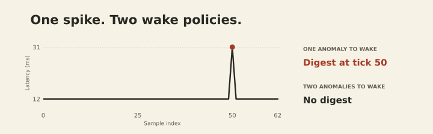
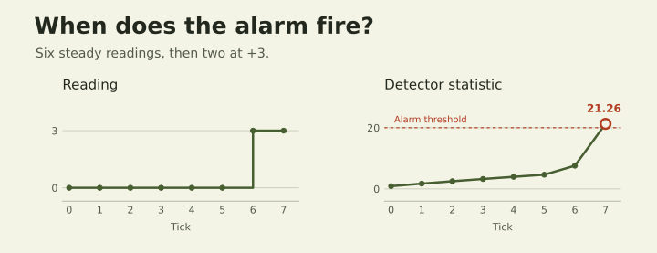

# ChronoSieve

**Decide when a stream of measurements should wake an agent.**

Put ChronoSieve between your telemetry collector and the code that pages a person or calls a model. Feed it timestamped observations and, optionally, forecasts. Each update returns a prediction interval and a `should_wake` decision. When the gate opens, `digest_markdown` contains a short account of the channel. Your application decides where to send it.



[Run the replay in Colab](https://colab.research.google.com/github/pgg898200-ship-it/chronosieve/blob/main/examples/replay_a_latency_spike.ipynb) · [Read the notebook](examples/replay_a_latency_spike.ipynb) · [Inspect the measured workloads](benchmarks/results_m4.json)

## Replay one latency spike

Install the tested revision using Git, CPython 3.10+ with development headers, and a C11 compiler. This command selects the system compiler on Linux or macOS. The extension has no Python runtime dependencies.

```bash
CC=cc python3 -m pip install "git+https://github.com/pgg898200-ship-it/chronosieve.git@743092a8c0da995a2e5007d7fea56ae16e669fe2"
```

This synthetic trace holds latency at 12 ms, injects one 31 ms observation, then returns to baseline. Run it with two anomaly-burst settings.

```python
from chronosieve import ChronoSieve

latency = [12.0] * 50 + [31.0] + [12.0] * 12
for burst in (1, 2):
    channel = ChronoSieve(channel="latency_ms", anomaly_burst=burst)
    wakes = []
    for t, value in enumerate(latency):
        result = channel.step(t, value, preds=[12.0])
        if result["should_wake"]:
            wakes.append(t)
    samples = channel.zoom(49, 51)["records"]
    print(burst, wakes, [row["y"] for row in samples])
```

```text
1 [50] [12.0, 31.0, 12.0]
2 [] [12.0, 31.0, 12.0]
```

The columns are the burst setting, the ticks that produced digests, and the original values at ticks 49 through 51. With `anomaly_burst=1` the isolated spike wakes the caller. With `anomaly_burst=2` this replay stays quiet. Both runs retain the exact readings until they age out of the ring buffer. A detected shift or a newly flagged forecaster can wake the caller independently of the burst setting.

## Choose an interface

| Your application | Entry point | Result |
|---|---|---|
| A telemetry collector feeding an alert rule or LLM | Python `ChronoSieve.step(t, y)` | Per-tick interval and wake decision, plus a Markdown digest on wake |
| A residual stream with a known baseline | `EDetector.step(residual)` | Sequential change statistic and alarm flag for the selected detector family |
| A stream in a file or shell pipeline | [Native CLI](#detect-a-change-with-the-native-cli) | The first alarm tick and detector statistic, in text or JSON |
| Several intermittent forecasters | `ChronoSieve.step(t, y, preds=…, active=…)` | Combined prediction and updated interval |
| An MCP client inspecting a channel | `chronosieve_ingest`, then `chronosieve_zoom` | Batch wake count and retained original samples over an inclusive time range |

After a detector alarm, [KthWake](https://github.com/pgg898200-ship-it/chronosieve/tree/releases/kthwake-0.1.0/companions/kthwake) can escalate recurring alarms and [Guardshift](https://github.com/pgg898200-ship-it/chronosieve/tree/releases/guardshift/guardshift) can route an alarm to a worker with capacity. Both have runnable examples below.

## Verified Apple M4 Benchmarks

Measured on **Apple M4 (macOS 15.3.2 arm64, Apple Clang 16.0.0, Python 3.14.6, NEON SIMD)**. Reproduce every number with `python3 benchmarks/run_all.py` (raw JSON saved in [benchmarks/results_m4.json](benchmarks/results_m4.json)).

### 1. Throughput (Native C11 CLI vs. Zero-Copy `Py_buffer` Batch vs. Scalar / Pure Python)

Native C11 CLI (`./chronosieve bench --n 2000000`) and Python `Py_buffer` batch (`benchmarks/bench_throughput.py`) are reported separately below so interface costs are never conflated:

| Kernel | Path / Interface | Latency | Throughput | Notes |
|---|---|---:|---:|---|
| **Catoni E-SR (16-lane, zero-`exp`)** | Native C11 CLI (`-O3 -mcpu=native`) | **8.82 ns/tick** | **113.4 M ticks/s** | Register-resident 8x NEON `f64x2` |
| **Catoni E-SR (16-lane, zero-`exp`)** | Python `ingest_batch` (`array.array('d')`) | **8.47 ns/tick** | **118.1 M ticks/s** | Zero-copy `Py_buffer`, GIL released, 0 deps (**111x** vs pure Py) |
| **Catoni E-SR (16-lane, zero-`exp`)** | Python `ingest_batch` (`numpy.ndarray`) | **9.03 ns/tick** | **110.7 M ticks/s** | Zero-copy `Py_buffer`, GIL released (**104x** vs pure Py) |
| **Catoni E-SR (16-lane, zero-`exp`)** | Python scalar `step(x)` loop | 347.81 ns/tick | 2.88 M ticks/s | Honest CPython call + dict allocation overhead |
| **Catoni E-SR (16-lane, reference)** | Pure Python loop | 936.58 ns/tick | 1.07 M ticks/s | Pure-Python reference baseline |
| **Vovk Rank B-tree (65k epoch cap)** | Native C11 CLI | **114.42 ns/tick** | **8.74 M ticks/s** | Exact distribution-free $O(\log n)$ arena B-tree |
| **Vovk Rank B-tree (65k epoch cap)** | Python `ingest_batch` (`Py_buffer`) | **115.49 ns/tick** | **8.66 M ticks/s** | Zero-copy `Py_buffer`, GIL released |
| **Conformal PID SoA (64 channels)** | Native C11 CLI | **2.39 ns/ch-tk** | **418.8 M ch-tk/s** | Vectorized NEON + rational `vtan` (`< 8e-16` err) |
| **Conformal PID SoA (64 channels)** | Python `ingest_batch` (`Py_buffer`) | **2.48 ns/ch-tk** | **402.8 M ch-tk/s** | Zero-copy 2D `Py_buffer`, GIL released |
| **Pre-Control E-Reset Conformal PID** | Python 1-ch `ingest_batch` | **127.29 ns/tick** | **7.86 M ticks/s** | Includes Vovk Rank B-tree (beats pure-Py vanilla PID at 190.3 ns) |
| **Sleeping BOA + Catoni ($K=8$)** | Native C11 CLI | **180.74 ns/step** | **5.53 M steps/s** | SIMD Estrin `vexpq_f64` (`< 5e-16` err) + 8 rogue Catonis |
| **Sleeping BOA + Catoni ($K=8$)** | Python `fuse_batch` (`Py_buffer`) | **181.56 ns/step** | **5.51 M steps/s** | Zero-copy 2D `Py_buffer`, GIL released |
| **Online COMA ($K=8$)** | Python `coma_merge()` call | **557.37 ns/call** | **1.79 M calls/s** | Exact $O(K \log K)$ union + hull + max agreement |
| **Swing PLA + Ring Buffer** | Native C11 CLI | **6.17 ns/tick** | **162.0 M ticks/s** | Exact ULP-guarded $L_\infty \le \epsilon$ + 65k circular ring buffer |
| **Swing PLA + Ring Buffer** | Python `digest_batch` (`Py_buffer`) | **6.69 ns/tick** | **149.5 M ticks/s** | Zero-copy `Py_buffer`, GIL released |

- **Native stripped C11 CLI size**: **103,712 bytes (101 KB)** (`< 150 KB`).
- **SIMD vs. portable scalar parity**: **NEON `max_rel = 1.136e-15`** and **x86_64 AVX2 `max_rel = 7.848e-16`** across all 79 outputs spanning all 4 modules (`< 1e-12`).
- **Memory safety**: Zero errors under `-fsanitize=address,undefined` (ASan + UBSan) on NEON, x86_64 AVX2, and SCALAR builds; zero warnings under `-Wall -Wextra -Wpedantic -Werror`.

### 2. Mathematical Invariants (Monte Carlo & Real-World `statsmodels` Verification)

All synthetic sequential tests run under exact null $H_0$ with target $\text{ARL} \ge \gamma = 200.0$ (160–200 trials, right-censored lower bound $\frac{1}{N}\sum \min(\tau_i, T_{\max})$):

| Guarantee / Primitive | Stress Distribution / Real Dataset | Measured Result | Target / Bound |
|---|---|---:|---:|
| **Bounded Betting E-SR** | $\text{Beta}(2,3) \to \text{Beta}(4,2)$ | $\text{ARL} \ge \mathbf{212.1}$ (ADD **9.1** ticks) | $\text{ARL} \ge 200$ |
| **Algebraic Catoni E-SR** | Heavy-tail Student-$t_3$ ($+1.5\sigma$ shift) | $\text{ARL} \ge \mathbf{306.7}$ (ADD **6.3** ticks) | $\text{ARL} \ge 200$ |
| **Algebraic Symmetry E-SR** | **Cauchy(0,1)** (infinite variance, $+2.0$ shift) | $\text{ARL} \ge \mathbf{232.9}$ (ADD **14.2** ticks) | $\text{ARL} \ge 200$ |
| **Vovk Rank B-tree E-SR** | Discrete Poisson(3) + Cauchy w/ epoch resets | $\text{ARL} \ge \mathbf{215.6}$ (ADD **18.7** ticks) | $\text{ARL} \ge 200$ |
| **Log-Domain E-CUSUM** | Heavy-tail Student-$t_3$ (valid mixture) | $\text{ARL} \ge \mathbf{2256.2}$ (ADD **8.9** ticks) | $\text{ARL} \ge 200$ |
| **Cross-Agent E-Fusion (Step)** | $K=8, \rho=0.85$ correlated Catoni | $\text{ARL} \ge \mathbf{266.1}$ (ADD **6.3** ticks) | $\text{ARL} \ge 200$ |
| **Cross-Agent E-Fusion (Process)** | $K=8, \rho=0.85$ correlated Vovk Rank | $\text{ARL} \ge \mathbf{215.7}$ (ADD **9.3** ticks) | $\text{ARL} \ge 200$ |
| **Pre-Control E-Reset PID** | 4,000 ticks, three 4x–5x volatility shocks | Full cov **0.901**; 100-tick shock cov **0.850** (vs **0.650** Rolling-D / **0.390** pure PID) | Target **0.900** |
| **Online COMA ($K=5$)** | Correlated agents ($\alpha=0.10$) | Det cov **0.901** (w=3.53); Rand cov **0.865** (w=**3.21**) | Floor $\ge 0.800$ |
| **Sleeping BOA + Rogue Catoni** | $K=6$ async agents, Agent 2 hallucinates $+3.0$ | Delay **1 tick**, exact isolation **True**, post-MAE **0.084** | Exact isolation |
| **Anomaly-Preserving Swing PLA** | 10,000 ticks ($\epsilon=0.05$, 3 spikes) | Max $L_\infty$ **0.050000**, anomaly err **0.0**, **28.1x** PLA | $L_\infty \le 0.05$ |
| **Real-World: Nile Flow (1871–1970)** | `statsmodels.nile` ($N=100$, **1898** Aswan dam, $1098\to850$) | Vovk Rank ($\gamma=50$, 0 priors): **1905** (+7 yr, **0** pre-1899 FA); 2-sided Catoni ($\gamma=100, z=2.5$): **1907** (+9 yr, **0** FA) | 0 pre-1899 FA |
| **Real-World: Sunspots (1732–2008)** | `statsmodels.sunspots` (causal 32-yr warmup, $N=277$ OOS, lag-1) | E-Reset PID cov **0.906** (3 resets) vs Rolling-D **0.888** vs Pure PID **0.866** | Target **0.900** |

### 3. LLM Token Reduction (Real-World Mauna Loa CO2 & 10,000-Tick Telemetry)

Both **BPE-Proxy** (alnum subword chunks + punctuation, close to `cl100k_base`) and **`chars/4`** token metrics are reported explicitly:

#### 3a. Real-World Mauna Loa Weekly CO2 (`statsmodels.co2`, 1958–2001, $N=2,225$, $\epsilon=1.0$ ppm — Full-Series, No Wake Gating)

Every representation below serializes the **entire 43-year trajectory** (no wake-up filtering); ChronoSieve's native C11 `StreamDigest.format_markdown()` compresses 2,225 weekly readings into **107 Swing PLA segments (20.8x)** with verified exact C float64 **$L_\infty = 1.000000 \le 1.00$ ppm** (**1.0004 ppm** reconstructed directly from the rendered 6-sig-fig Markdown text):

| Representation (Full 2,225-Point CO2 Series) | Chars | `chars/4` | BPE-Proxy | Reduction vs. JSON (`BPE` / `c/4`) | Reduction vs. TSLN (`BPE` / `c/4`) |
|---|---:|---:|---:|---:|---:|
| Raw JSON (`[{"t":...,"y":...}]`) | 45,616 | 11,404 | 35,601 | — | — |
| Raw CSV (`t,y`) | 25,593 | 6,398 | 11,128 | 68.7% / 43.9% | — |
| TSLN-style Delta Text (all windows) | 12,726 | 3,181 | 10,620 | 70.2% / 72.1% | — |
| **ChronoSieve Native Swing PLA Digest** (107 segs, $L_\infty \le 1.0$ ppm) | **5,325** | **1,331** | **2,988** | **91.6% / 88.3%** | **71.9% / 58.2%** |

#### 3b. 10,000-Tick Multi-Regime Telemetry Stream (2 Shifts, 3 Isolated Spikes)

| Representation (10,000 ticks, 2 shifts, 3 spikes) | Chars | `chars/4` | BPE-Proxy | Reduction vs. JSON (`BPE` / `c/4`) | Reduction vs. TSLN (`BPE` / `c/4`) | Spike Recall (Pinned / Wake Pkts) |
|---|---:|---:|---:|---:|---:|---:|
| Raw JSON (`[{"t":...,"y":...}]`) | 221,684 | 55,421 | 163,928 | — | — | 100% / — |
| Raw CSV (`t,y`) | 122,820 | 30,705 | 53,930 | 67.1% / 44.6% | — | 100% / — |
| TSLN-style Delta Text (all windows) | 52,846 | 13,211 | 44,530 | 72.8% / 76.2% | — | 100% / — |
| **ChronoSieve High-Recall** (`burst=1`, 25 pkts, ~195 `c/4` / ~416 BPE tok/pkt) | 19,481 | 4,870 | 10,404 | **93.7% / 91.2%** | **76.6% / 63.1%** | **100% / 100%** (3/3) |
| **ChronoSieve Wake-Up Gated** (`burst=2`, 14 pkts, ~199 `c/4` / ~429 BPE tok/pkt) | **11,150** | **2,787** | **6,000** | **96.3% / 95.0%** | **86.5% / 78.9%** | **100% / 0%** (`burst=2` gates 1-tick spikes) |

- Note on spike recall: in **both** modes, all 3/3 injected spikes are pinned verbatim (`0.0` error) in `StreamDigest` and recoverable via `zoom()`. Use `anomaly_burst=1` (high-recall mode) to wake the LLM immediately on isolated 1-tick spikes (**100%** wake-packet recall), or `anomaly_burst=2` (gated mode) to wake only on certified regime shifts and $\ge 2$-tick anomaly bursts.

---

## Ecosystem Comparison

We credit strong compiled incumbents in each individual silo (`river` Rust, `conformal-prediction`/`risksieve` Rust, `stcpR6` Rcpp, `TerseTS` Zig, `tsln-python`). ChronoSieve's edge is fusing all four mathematically certified streaming primitives in one zero-dependency C11/SIMD engine with native MCP + CLI + zero-copy `Py_buffer`:

| Capability | `river` (Rust/Py) | `conformal-prediction` / `risksieve` (Rust) | `stcpR6` (Rcpp) | `TerseTS` (Zig) | `tsln-python` | **ChronoSieve (C11/SIMD)** |
|---|:---:|:---:|:---:|:---:|:---:|:---:|
| Zero-`exp` SIMD E-Detectors (Catoni/Symmetry/Vovk Rank) | — | — | Partial | — | — | **Yes (113M CLI / 118M Py)** |
| Correlated Cross-Agent E-Fusion ($\text{ARL} \ge \gamma$) | — | — | — | — | — | **Yes** |
| Pre-Control E-Reset Conformal PID + SoA SIMD + COMA | — | Partial | — | — | — | **Yes (419M CLI / 403M Py)** |
| Sleeping Fixed-Share BOA + Rogue Agent Quarantine | — | — | — | — | — | **Yes** |
| Exact $L_\infty \le \epsilon$ Swing PLA + Lossless `zoom()` | — | — | — | PLA only | Delta text | **Yes + Wake Gate** |
| Zero Runtime Deps + 101 KB CLI + Stdio MCP Server | No | No | R only | CLI/lib | Python | **Yes (0 deps)** |

---

## Build from a checkout

```bash
# Python C11/SIMD extension (zero runtime dependencies, auto-enables NEON on arm64)
python3 -m pip install --no-build-isolation -e .

# Optional x86_64 AVX2 build:
CHRONOSIEVE_AVX2=1 python3 -m pip install --no-build-isolation -e .

# Native 101 KB C11 CLI binary:
make cli
```

---

## Optional repeated-alarm escalation

The [incident example](examples/alarm_escalation.py) feeds the actual `EDetector.step` alarm flag into [KthWake](https://github.com/pgg898200-ship-it/chronosieve/tree/releases/kthwake-0.1.0/companions/kthwake). It emits a watch on the first alarm in 3 ms and escalates after three alarms in 9 ms. Auto-reset starts a new detector run after each alarm. Each policy emits one update when its state changes, including idle expiry. The default replay injects a shift into synthetic residuals; adjust the detector and policies for your stream.

From a ChronoSieve checkout with CPython, setuptools, wheel and C/C++17 compilers:

```bash
KTHWAKE_SOURCE='git+https://github.com/pgg898200-ship-it/chronosieve.git@7cca93890a5bfa1e120f6aaabda8d1b8d7957b1f#subdirectory=companions/kthwake'
python3 -m pip install --no-build-isolation . "${KTHWAKE_SOURCE}"
python3 examples/alarm_escalation.py
python3 examples/verify_alarm_escalation.py
```

Set `KTHWAKE_SOURCE` to a local source checkout for development. Pass `--stdin` to replay JSONL rows with `t_ms` and `residual`. Supply observations in nondecreasing timestamp order. The example groups alarms at equal timestamps and emits silent-period updates at their logical deadlines when more data arrives or input closes. A live event loop can arm its timer at `Index.next_expiry()`.

## Quickstarts

### 1. Python Zero-Copy Batch & Multi-Agent Pipeline (Zero Dependencies)

```python
import array
import chronosieve as cs

# 1) 110M+ ticks/sec zero-copy Catoni E-Detector (works with stdlib array.array OR NumPy)
xs = array.array("d", [0.0] * 1000 + [2.5] * 100)
alarms = bytearray(len(xs))
det = cs.EDetector(family="catoni", mu0=0.0, sigma=1.0, threshold=500.0)
res = det.ingest_batch(xs, out_alarms=alarms)
print("First certified shift tick:", alarms.index(1), "ARL >= 500")

# 2) Unified multi-agent pipeline: Sleeping BOA + Pre-Control E-Reset PID + COMA + Swing PLA
pipe = cs.ChronoSieve(channel="gpu_temp", n_agents=3, alpha=0.10, epsilon=0.05)
out = pipe.step(
    t=42.0,
    y=71.2,
    preds=[71.0, 71.4, 95.0],       # Agent 2 hallucinating
    active=[1, 0, 1],               # Agent 1 sleeping asynchronously
    agent_intervals=[(70.5, 71.5), (70.8, 72.0), (94.0, 96.0)],
)
if out["should_wake"]:
    print(out["digest_markdown"])   # ~195-token Markdown packet for System-2 LLM
    raw = pipe.zoom(35.0, 42.0)     # Exact lossless ring-buffer drill-down
```

### Detect a change with the native CLI

From a checkout with Make and a C11 compiler, feed eight readings into the Catoni detector.

```sh
make cli
printf '%s\n' 0 0 0 0 0 0 3 3 | ./chronosieve detect --family catoni --mu0 0 --sigma 1 --threshold 20
```

```text
ALARM tick=7 stat=21.2617 threshold=20.00
```



In this synthetic trace the alarm arrives on the second changed reading, at zero-based tick 7. The CLI then prints a summary. Add `--json` for a single machine-readable record. Run `./chronosieve detect --help` for the input format and options.

Other native commands can summarize a series or time the kernels on this machine.

```sh
seq 1 200 | awk '{print $1 "," ($1==120 ? 50.0 : sin($1*0.05))}' | ./chronosieve digest --eps 0.05 --channel sensor_0
./chronosieve bench --n 2000000
```

### 3. Zero-Dependency Stdio MCP Server

```bash
python3 -m chronosieve.mcp_server
# or installed entrypoint:
chronosieve-mcp
```

Add to Claude Desktop / Cursor / any MCP client:

```json
{
  "mcpServers": {
    "chronosieve": {
      "command": "python3",
      "args": ["-m", "chronosieve.mcp_server"]
    }
  }
}
```

Tools exposed: `chronosieve_create_channel`, `chronosieve_ingest`, `chronosieve_zoom`, `chronosieve_digest`, `chronosieve_coma`, `chronosieve_status`.

### 4. Pure C11 Embedding

```c
#include "chronosieve.h"
// Link csrc/edetector.c csrc/conformal.c csrc/fuser.c csrc/digest.c -lm
```

---

## Route a wakeup to a worker

ChronoSieve can signal when a stream changes. [Guardshift](https://github.com/pgg898200-ship-it/chronosieve/tree/releases/guardshift/guardshift) can combine that alarm with capacity, queue depth, or another integer condition and emit one enter/exit event per affected worker. The [runnable integration example](https://github.com/pgg898200-ship-it/chronosieve/blob/releases/guardshift/guardshift/examples/chronosieve_routing.py) feeds a batch through `EDetector` and dispatches the first alarm when capacity is available. [Try atomic updates in the browser](https://huggingface.co/spaces/pgg-engineering/guardshift).

## For AI & Coding Agents

- Machine-readable index: [llms.txt](llms.txt)
- Complete technical spec & API reference: [llms-full.txt](llms-full.txt)
- Drop-in agent skill file: [SKILL.md](SKILL.md)

## Verification & Reproducibility

```bash
make test                    # C11 ASan+UBSan (NEON & Scalar) + <1e-12 parity + 29 pytest tests
make lint                    # clang -Wall -Wextra -Wpedantic -Werror + ruff + mypy
python3 benchmarks/run_all.py
```

## License

MIT — see [LICENSE](LICENSE).
